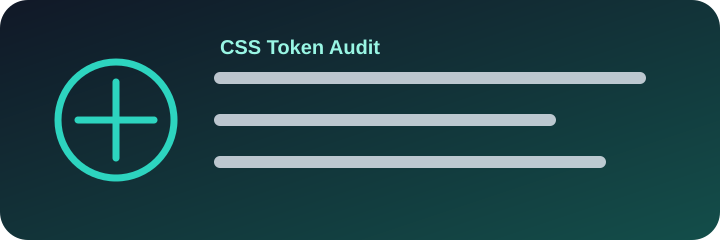

## 🧭 Overview
Audit CSS custom properties to find duplicate definitions, unused tokens, and var() references that have no definition.

## ✨ Features
- 🎨 Find custom properties declared more than once.
- 🔎 Detect var() references without a matching definition.
- 🧹 List tokens that are defined but never referenced.
- ⚙️ Run locally with Python's standard library.

## 🖥️ Demo
~~~bash
python main.py examples/styles.css
~~~
Try it with the included sample input or your own local files.

## 🚀 Quick Start
~~~bash
git clone https://github.com/CyberLoop-dev/css-token-audit.git
cd css-token-audit
python main.py examples/styles.css
~~~

## 🧰 Tech Stack
- Python 3.10+
- re, pathlib, argparse, collections (standard library)

## 🗂️ Folder Structure
~~~text
css-token-audit/\n├── assets/icon.svg\n├── examples/styles.css\n├── tests/test_main.py\n├── LICENSE\n├── README.md\n├── main.py\n└── requirements.txt
~~~

## 🗺️ Roadmap
- [ ] Add JSON output for CI integrations.
- [ ] Improve parsing around nested CSS functions and preprocessors.

## 🤝 Contributing
Issues and focused pull requests are welcome. Add tests for behavior changes and keep the project easy to run locally.

## 📄 License
Released under the MIT License. See LICENSE.

